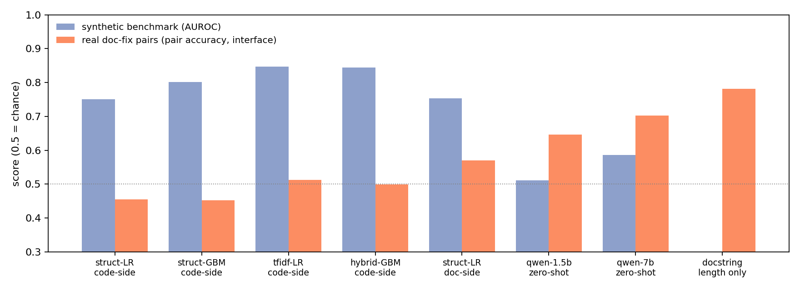

# DocDrift — Documentation Drift Detection

**Does a docstring still describe its code?** This repository studies *documentation drift*
detection from the (code, docstring) pair alone, and how such detectors should be evaluated.

📄 **Paper draft:** [`docs/paper.md`](docs/paper.md) — *Synthetic Drift Does Not Transfer:
Evaluating Docstring–Code Inconsistency Detectors on 6,890 Real Documentation Fixes*
📋 **Pre-registered protocol:** [`docs/PROTOCOL_real_drift.md`](docs/PROTOCOL_real_drift.md)
📦 **Dataset:** [`dataset/docfix_pairs.jsonl.gz`](dataset/) — 6,890 real doc-fix pairs from 33 Python projects

## Key findings



1. Detectors trained on mutated code score **0.60–0.96 AUROC** on synthetic drift but are at
   chance on **real** documentation fixes (pair accuracy 0.39–0.60 across 28 variants).
2. Leave-one-mutation-out AUROC does **not** predict real performance (ρ = −0.26).
3. Mechanism: code-side mutations teach "docstring names something not in the signature ⇒
   drift", while real fixes routinely add such names — detectors punish better documentation.
4. A "shorter docstring is stale" rule scores **0.78**: doc-fix benchmarks need length control.
5. Under length control, zero-shot code LLMs (Qwen2.5-Coder 1.5B/7B) are the only detectors
   clearly above chance (0.57–0.59), including on pairs of identical length.

## Layout

| Path | Content |
|---|---|
| `docdrift/corpus.py`, `mutations.py`, `features.py`, `models.py` | corpus mining, code-side mutations, 32 alignment features, detectors |
| `docdrift/realdrift.py` | mining real doc-fix pairs from git history |
| `docdrift/docmutations.py` | doc-side mutation operators (drift in the docstring, code fixed) |
| `experiments/exp1–exp7` | original synthetic study (see `REPORT.md`) |
| `experiments/exp8, exp8b` | mine and characterise real doc-fix pairs |
| `experiments/exp9, exp9b` | 28 code-side variants on real pairs; mechanism, categories, annotation |
| `experiments/exp10` | doc-side benchmark and evaluation |
| `experiments/exp11, 11b, 11c` | zero-shot LLM judges (GPU); length and contamination checks |
| `scripts/build_corpus.sh` | pinned corpus: CPython 3.13.1 `Lib/` + 35 pinned packages |
| `runs/` | outputs of every run (CSVs, logs, figures, model scores) |
| `tests/` | unit tests (`python -m unittest discover -s tests`) |

## Reproduce

```bash
pip install -r requirements.txt
bash scripts/build_corpus.sh corpus_src
DOCDRIFT_CORPUS=corpus_src bash run_all.sh                 # exp1–7, synthetic study (~45 min CPU)
cd experiments
python exp8_mine_real_drift.py && python exp8b_characterise_real_drift.py   # clones 33 repos (~1.5 h)
python exp9_real_drift_eval.py && python exp9b_real_drift_analysis.py
python exp10_doc_side_drift.py
python exp11_llm_judge.py qwen-1.5b && python exp11_llm_judge.py qwen-7b    # needs a GPU (T4 is enough)
```

All results in the paper were produced on free Google Colab runtimes. The original synthetic
study is described in [`REPORT.md`](REPORT.md); note that its corpus is the standard library
**plus the third-party packages installed** in the interpreter — results replicate within
≈ 0.01 AUROC on the pinned corpus (`runs/colab_pinned_corpus/`).
