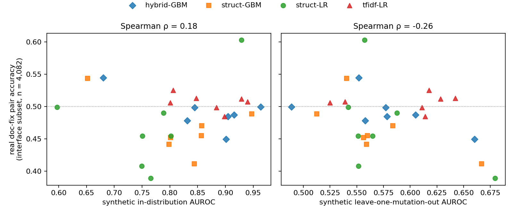
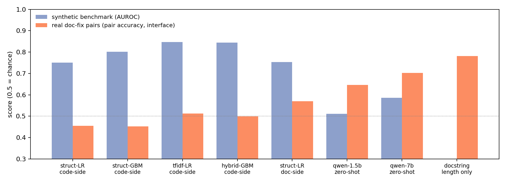

# Synthetic Drift Does Not Transfer: Evaluating Docstring–Code Inconsistency Detectors on 6,890 Real Documentation Fixes

**Arush Badhe** · Draft, November 2026 · Code, data and pre-registered protocol: <https://github.com/Arubad/Doc_drift> (branch `real-drift-study`)

---

## Abstract

Detectors of *documentation drift* — a docstring that no longer describes its code — are
trained and evaluated almost exclusively on synthetic drift produced by mutating code. We ask
whether that synthetic performance says anything about real drift. We mine **6,890 real
doc-fix pairs** from the git histories of 33 widely used Python projects: commits that edited a
function's docstring while leaving its code byte-identical (AST-level), so the old docstring is
the drifted version and the new one the fix. Following a protocol committed before each
experiment, we evaluate 28 mutation-trained detector variants, detectors trained on a new
*doc-side* mutation benchmark, and two zero-shot code LLMs. We find: (1) mutation-trained
detectors score 0.60–0.96 AUROC on synthetic drift but **0.39–0.60 pair accuracy on real
fixes — at or below chance**; (2) leave-one-mutation-out AUROC, the natural proxy for
generalisation, does not predict real performance (Spearman ρ = −0.26, 95 % CI [−0.34, −0.15]);
(3) the failure has a concrete mechanism — code-side mutations teach that "the docstring names
something not in the signature" signals drift, while real fixes routinely *add* such names;
(4) a docstring-length rule ("the shorter docstring is the stale one") reaches 0.78, so
benchmarks built from doc-fix commits are dominated by a length confound unless
length-controlled; (5) under length control, zero-shot LLMs that never saw a mutation are the
only detectors clearly above chance (Qwen2.5-Coder-7B: 0.59 [0.57, 0.61] on length-matched
pairs; 0.59 on pairs of identical length, where length carries no signal). Synthetic
benchmarks for documentation drift measure something different from real drift.

---

## 1 Introduction

Stale documentation misleads API users and, increasingly, the code LLMs that read docstrings
as ground truth. Comment–code inconsistency detection has therefore received steady attention,
mostly as a *just-in-time* task conditioned on a code change [Liu et al. 2018; Panthaplackel
et al. 2021], and mostly trained on synthetic or heuristically labelled data. A model that
sees only the current (code, docstring) pair — what a linter or an LLM agent faces — is
typically trained by mutating code under an unchanged docstring.

A prior study in this repository (REPORT.md) showed that such detectors collapse when one
mutation type is held out (leave-one-mutation-out, LOMO: −0.15 to −0.18 AUROC), and proposed
LOMO AUROC as the number that predicts real-world usefulness. This paper tests that claim, and
the broader assumption behind synthetic evaluation, on real drift.

**Contributions.**
1. **DocFix-6.9k:** 6,890 real doc-fix pairs (4,082 touching interface claims) from 33
   repositories, with edit categories, a 150-pair label-quality annotation, and a
   pre-registered protocol (`docs/PROTOCOL_real_drift.md`).
2. **A negative transfer result:** 28 mutation-trained variants across 4 model families and
   7 training regimes are at chance on real fixes; LOMO AUROC does not predict real accuracy.
3. **A mechanism** for the failure, and a doc-side mutation benchmark that mirrors how real
   drift is fixed (which helps only marginally).
4. **A methodological warning:** doc-fix benchmarks are confounded by docstring length; we
   give a length-matched evaluation and show that, under it, zero-shot code LLMs carry real
   signal that mutation-trained detectors lack.

## 2 Data

### 2.1 Synthetic benchmarks
**Corpus.** 20,758 documented functions (183 top-level packages) from CPython 3.13.1 `Lib/`
plus 35 version-pinned PyPI packages (`scripts/build_corpus.sh`); docstrings ≥ 8 words,
functions 3–80 lines. Replicating the original study on this pinned corpus reproduces all
headline numbers within ≈ 0.01 AUROC (`runs/colab_pinned_corpus/`).

**Code-side mutations** (from the original study): 10 drift operators that edit code under an
unchanged docstring — surface (rename/remove/add parameter, change default), behavioural
(add/remove raise, return→yield, wrap return value) and semantic (negate condition, swap
operator) — plus 2 benign code edits as hard negatives; 98,834 rows.

**Doc-side mutations** (new, `docdrift/docmutations.py`): 8 operators that edit the
*docstring* under unchanged code — rename a documented parameter, drop a parameter's
description, swap return/yield wording, drop or invent a `Raises`, change a documented default,
swap a type word, insert a negation — and 3 benign doc edits (reflow, identifier-safe synonym
swap, drop an Examples/See Also/Notes section). All rows are rendered identically
(`ast.unparse` with the cleaned docstring), replacement names come from corpus-mined pools,
and mean docstring length is matched across labels (62.4 vs 63.3 words); 93,934 rows.

### 2.2 Real doc-fix pairs
From the GitHub histories (since 2012) of 33 of the corpus packages we take every non-merge
commit touching ≤ 3 non-test `.py` files and ≤ 60 lines, and every function whose docstring
changed while its **code AST (docstring removed) is identical**. The pre-commit
(code, docstring) is labelled drifted, the post-commit one consistent. Exclusions, all fixed
before evaluation: commits editing > 3 docstrings (style sweeps), test/doc/example paths,
trivial edits (whitespace, punctuation, reST roles and link targets, version directives,
single-token typos), short docstrings, and exact duplicates. Result: **6,890 pairs from
5,644 commits**; 4,082 pairs (3,462 commits) touch an interface claim (parameter, return/yield,
exception, type or default — the **interface** subset, our primary evaluation set).

**Label quality.** A stratified random sample of 150 pairs was annotated as *factual* (old
docstring wrong), *incomplete* (old docstring omitted behaviour the code has), *clarity*
(rewording) or *noise*. Precision (factual + incomplete) is **0.55 overall and 0.65 on the
interface subset**. On a non-drift pair both docstrings are acceptable, so even a perfect
detector scores ≈ 0.5 there; the implied ceiling for pair accuracy is ≈ **0.83** on the
interface subset. One sampled "fix" *introduced* drift (a documented parameter renamed
`seed`→`entropy` while the signature kept `seed`).

## 3 Method

**Detectors.** Four families from the original study — logistic regression and gradient
boosting on 32 structural code–docstring alignment features (struct-LR, struct-GBM), TF-IDF
over code identifiers and docstring tokens (tfidf-LR), and a hybrid (hybrid-GBM) — each trained
under 7 code-side regimes (all operators; surface; behavioural; semantic; surface+behavioural;
interface-only; all with clean-only negatives) = 28 variants, and under 2 doc-side regimes
(doc-side only; doc+code). Zero-shot judges: Qwen2.5-Coder-1.5B-Instruct (fp16) and
-7B-Instruct (4-bit NF4), with one fixed prompt asking whether the docstring accurately
describes the code's parameters, return value, exceptions and behaviour; drift score =
P(No)/(P(Yes)+P(No)) from next-token logits.

**Metrics.** Synthetic: in-distribution AUROC and LOMO AUROC. Real: **pair accuracy**, the
probability that the old docstring scores as more drifted than the new one (ties ½). Because the
code is identical within a pair, a detector can only succeed by judging docstring against code.
**Leakage control:** real-pair scores come from models trained without any synthetic function of
the pair's package (5 package folds). **Uncertainty:** cluster bootstrap over commits (B = 1,000
or 2,000). **Length control:** a length-only baseline (score = −words) and a length-matched
subset (|Δwords| ≤ 10 %; 1,641 interface pairs).

**Pre-registration.** Hypotheses H1–H3 were committed before any real-pair evaluation
(`20f3a9b`), H4 before any doc-side code (`07a3375`, `e4e3734`), and H5 before any LLM run
(`d83d109`). Post-hoc analyses are labelled exploratory and listed with all deviations in the
protocol.

## 4 Results

*Figure 1. Each point is one of 28 code-side detector variants. Neither synthetic metric
predicts accuracy on real doc-fix pairs; all variants sit near chance (dotted line).*

### 4.1 Mutation-trained detectors are at chance on real drift (H2: supported)
Across the 28 variants, synthetic in-distribution AUROC spans 0.60–0.96 while real pair
accuracy on the interface subset spans **0.39–0.60** and real AUROC **0.497–0.520**. Most
variants are *below* 0.5. On the 83 annotated pairs verified as genuine drift, accuracy is
0.42–0.60. No edit category (parameter, return, raise, type, default, prose) is reliably
detected (H3: not supported).

### 4.2 LOMO does not predict real performance (H1: not supported)
Spearman correlation with real pair accuracy is ρ = 0.18 [0.09, 0.29] for in-distribution
AUROC and **ρ = −0.26 [−0.34, −0.15] for LOMO AUROC** (difference −0.44 [−0.56, −0.29]); the
`all` subset gives the same picture. Because every variant is near chance, the spread being
correlated is small, and we read this as "neither synthetic number is informative", not as
evidence that LOMO is harmful.

### 4.3 Mechanism: real fixes add names that code-side training punishes
In 22 % of interface pairs (889) the fixed docstring mentions *more* names that do not match
the signature — documented `**kwargs` keys, attributes, sub-options. Code-side training makes
"docstring names something not in the signature" a near-perfect drift cue (it is exactly the
`rename_param` operator's footprint). On those 889 pairs, struct-LR (surface regime) picks the
correct docstring **9 %** of the time and struct-GBM (all operators) 24 %; on the remaining
pairs both are near 0.5. The detectors penalise better documentation.

### 4.4 Doc-side training helps only marginally (H4: partially supported)
Trained on doc-side drift, struct-LR reaches 0.570 [0.555, 0.585] on interface pairs and
0.559 [0.535, 0.583] on length-matched pairs — above chance — but the other three families
remain at 0.47–0.54, and no doc-side model beats the best code-side variant of its family on
the full interface subset (H4's pre-registered criterion). Doc-side detectors also collapse
under LOMO over doc operators (0.47–0.55), reproducing the operator-artifact problem on the
docstring side.

### 4.5 A length confound dominates doc-fix benchmarks
Developers fixing docstrings mostly add text: the new docstring is longer in 73 % of interface
pairs. The rule "shorter docstring = drifted" reaches **0.781** on interface pairs — above
every trained detector and close to the label-quality ceiling — and still 0.629 on the
length-matched subset. Any evaluation built from doc-fix commits must control for length.

### 4.6 Zero-shot LLMs carry real signal (H5: supported; H5b: not supported)

| Detector | Synthetic AUROC | Real, interface | Real, length-matched | Real, identical length |
|---|---|---|---|---|
| Best code-side variant | 0.60–0.96 | 0.603 | — | — |
| struct-LR, doc-side | 0.75 | 0.570 | 0.559 [0.535, 0.583] | — |
| Qwen2.5-Coder-1.5B, zero-shot | 0.51 | 0.646 | 0.568 [0.544, 0.593] | 0.601 [0.552, 0.650] |
| Qwen2.5-Coder-7B, zero-shot | 0.59 | **0.702** | **0.590** [0.566, 0.614] | 0.586 [0.536, 0.635] |
| Docstring length only | — | 0.781 | 0.629 | 0.500 |

*Figure 2. Synthetic score (blue; AUROC on the detector's own synthetic benchmark, or on a
1,000-row code-side sample for the LLMs) against real pair accuracy (orange; interface
subset). Mutation-trained detectors and zero-shot LLMs fail in opposite directions.*

Both LLMs beat chance on length-matched pairs (H5), but not the length rule (H5b). Two
exploratory checks address the obvious objections. *Residual length:* on the 420 length-matched
pairs whose docstrings have identical word counts — where the length rule is exactly 0.5 — both
LLMs are above chance (0.60 and 0.59), and their score differences barely correlate with length
differences (ρ = 0.03–0.05). *Training-data contamination:* Qwen2.5-Coder was released in
September 2024; on the 417 interface pairs committed after 2024-10-01, accuracy is unchanged or
higher (7B 0.71, 1.5B 0.70 vs 0.70 and 0.64 before), although the corresponding length-matched
subset is small (139 pairs, 7B 0.57 [0.48, 0.65]).

The two kinds of detector fail in opposite ways: mutation-trained models excel on synthetic drift
and are blind to real drift; zero-shot LLMs are near chance on synthetic drift and the only
detectors with clear real signal.

## 5 Discussion

**What synthetic drift measures.** Code-side mutation benchmarks reward detecting the footprint
of the mutation, not the disagreement between code and documentation. The footprints do not
occur in real drift, and one of them (unmatched documented names) is anti-correlated with drift
in practice. Holding a mutation type out (LOMO) exposes this but does not measure what matters.

**Recommendations for evaluating drift detectors.** (1) Report results on real pairs, not only
synthetic drift. (2) Use pairs with identical code and report pair accuracy, so the detector must
judge the docstring. (3) Control for docstring length, and report a length-only baseline next to
every number. (4) Report label precision, and the accuracy ceiling it implies.

**Limitations.** Python only, 33 repositories. Labels come from developer commits with estimated
precision 0.65 (interface subset); the precision estimate rests on one annotator so far (an LLM
assistant; a second, human pass is planned, §6). The H1 test is weak because all variants sit near
chance. The "best code-side variant" used for H4 comparisons was selected on the real pairs, which
favours the code side. The LLM results use one fixed prompt and two model sizes; the identical-
length and contamination checks are post hoc. Pre-registration is by git commits in this
repository; the commits were pushed publicly only after the study finished, so their timestamps
are self-reported.

## 6 Status and next steps
* Second, independent human annotation of 50 pairs (`runs/real_drift/ANNOTATE_ME.md`) to report
  Cohen's κ.
* Larger LLM judges and prompt-robustness checks (with prompts fixed in advance).
* Extending the length-matched evaluation into a public benchmark split.

## Reproducibility
All experiments ran on free Google Colab runtimes (CPU; one T4 GPU for exp11). Code:
`experiments/exp1–exp11c`; data: `dataset/docfix_pairs.jsonl.gz` (pairs) and
`dataset/annotations_annotator_A.csv`; per-experiment outputs in `runs/`; protocol and
deviations in `docs/PROTOCOL_real_drift.md`.

**Use of AI assistance.** Experiment code, analyses and this draft were produced with an AI coding
assistant (Claude) under the author's direction; the first annotation pass (annotator A) was done
by the same assistant and is labelled as such in the data.

## References
* Liu, Z. et al. (2018). Just-in-time obsolete comment detection, ASE. **[citation details to verify]**
* Panthaplackel, S., Li, J. J., Gligoric, M., Mooney, R. J. (2021). Deep Just-In-Time
  Inconsistency Detection Between Comments and Source Code. AAAI.
* Wen, F., Nagy, C., Bavota, G., Lanza, M. (2019). A Large-Scale Empirical Study on Code-Comment
  Inconsistencies. ICPC.
* Hui, B. et al. (2024). Qwen2.5-Coder Technical Report. arXiv:2409.12186.

*(References to be verified before submission.)*
